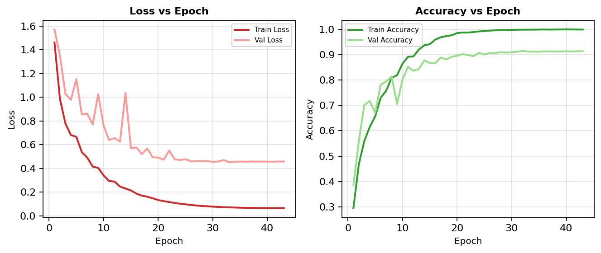
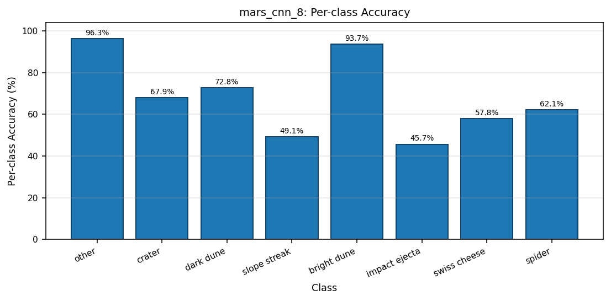
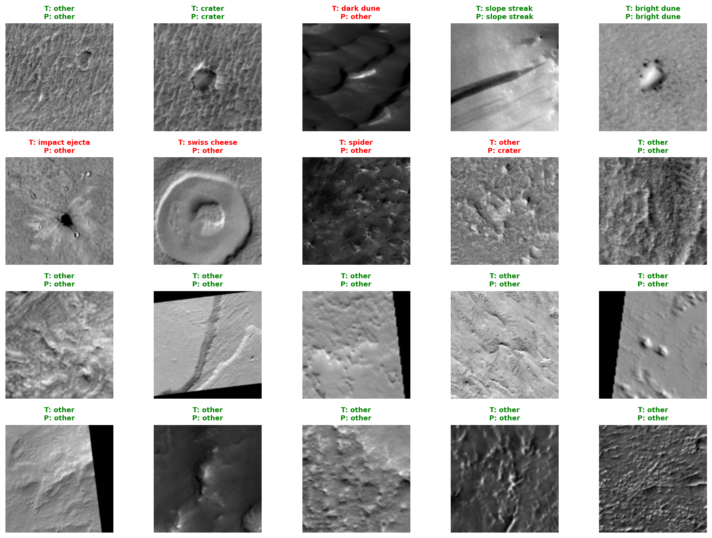
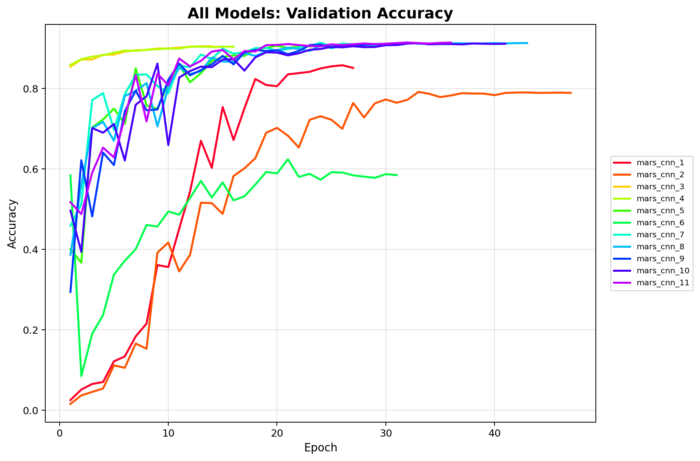

# Mars Terrain Classification CNN

A convolutional neural network in TensorFlow and Keras that classifies orbital images of the Martian surface into 8 terrain types, trained on 73,031 labelled HiRISE images. MSc coursework for *Deep Learning* at Queen Mary University of London.

## Result

The best model (run `mars_cnn_8`, chosen from 11 configurations on macro F1) was evaluated on a held-out test set of 14,607 images:

| Metric | Value |
|---|---|
| Accuracy | 91.5% |
| Macro F1 | 0.72 |
| Weighted F1 | 0.91 |

| Class | Precision | Recall | F1 | Test images |
|---|---|---|---|---|
| Other | 0.94 | 0.96 | 0.95 | 12,212 |
| Crater | 0.80 | 0.68 | 0.73 | 980 |
| Dark dune | 0.71 | 0.73 | 0.72 | 228 |
| Slope streak | 0.60 | 0.49 | 0.54 | 466 |
| Bright dune | 0.91 | 0.94 | 0.93 | 350 |
| Impact ejecta | 0.81 | 0.46 | 0.58 | 46 |
| Swiss cheese | 0.79 | 0.58 | 0.67 | 230 |
| Spider | 0.66 | 0.62 | 0.64 | 95 |

The dataset is dominated by the "other" class (83.6% of images), which drives the overall accuracy. Macro F1 weighs every class equally and shows where the model struggles: slope streaks are the hardest class, and impact ejecta and spiders are the rarest.





## Approach

- **Data:** NASA's HiRISE labelled data set (version 3), with 8 classes: other, crater, dark dune, slope streak, bright dune, impact ejecta, swiss cheese and spider. Images are converted to grayscale, resized to 160×160 and scaled to [0, 1], then split 70/10/20 into training, validation and test sets with stratified sampling.
- **Class imbalance:** class weights inversely proportional to class frequency. Focal loss was also tested as an alternative.
- **Model:** three convolution blocks (32, 64 and 128 filters), each with batch normalisation and ReLU, with max pooling after the first two. These feed a 128-unit dense layer with batch normalisation and 30% dropout, and a softmax output. He initialisation and L2 regularisation (5e-5), with about 21.3 million trainable parameters.
- **Training:** Adam (learning rate 5e-4), batch size 64, up to 100 epochs, early stopping on validation loss (patience 10), and the learning rate reduced by a factor of 0.75 whenever validation loss stalled. Training stopped at epoch 43.
- **Experiment tracking:** every run saves its parameters, training history, architecture, confusion matrix, classification report and test results to `results/<run>/`, so runs can be compared and replayed.

## Model development

Eleven configurations were trained, each building on the last, and compared on macro F1.



## Running it

1. Download the dataset (reference below) and place it in `Data/`, so that the images are in `Data/map-proj-v3/` and the labels file is `Data/labels-map-proj-v3.txt`.
2. Install the requirements:
   ```bash
   pip install -r requirements.txt
   ```
3. Run the script:
   ```bash
   python mars_cnn.py
   ```

The settings at the top of `mars_cnn.py` match the best run, `mars_cnn_8`. Each run is saved under `MODEL_NAME` (currently `mars_cnn_12`), so running the script trains a new run without overwriting the reported one. The trained model (244 MB) is not included because it is over GitHub's file size limit.

## Files

- `mars_cnn.py`: data pipeline, model, training, evaluation and plots
- `results/`: plots and saved metrics from the best run
- `report.pdf`: the full write-up

## Reference

NASA (2022). *Mars Orbital Image (HiRISE) Labeled Data Set Version 3.* https://data.nasa.gov/dataset/mars-orbital-image-hirise-labeled-data-set-version-3
